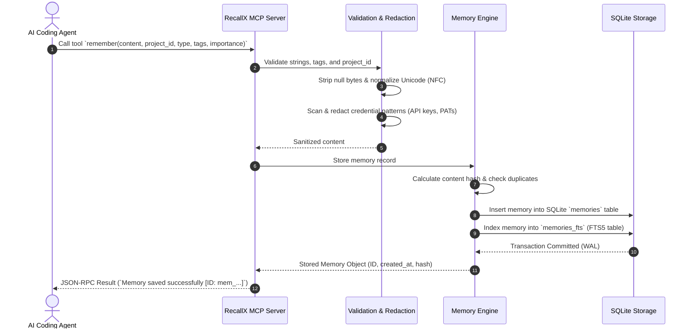
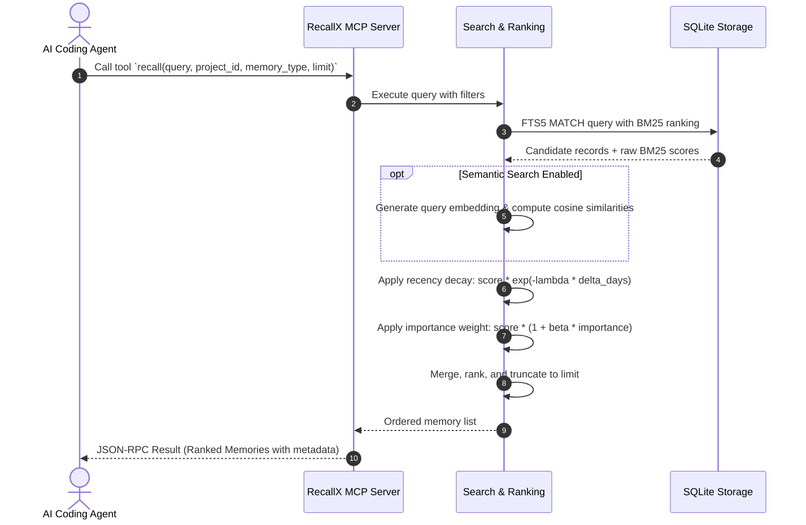

# RecallX Architecture

RecallX is a local-first, low-latency persistent memory subsystem engineered specifically for AI coding agents. It provides deterministic storage, structured memory schemas, hybrid full-text and vector search, and standardized Model Context Protocol (MCP) tool bindings.

---

## High-Level System Architecture

RecallX operates entirely on the local developer machine without external API dependencies or telemetry.

```
┌────────────────────────────────────────────────────────────────────────┐
│                        AI Coding Agent Layer                           │
│     (Claude Code, Cursor IDE, Gemini CLI / Antigravity, Codex, etc.)    │
└───────────────────────────────────┬────────────────────────────────────┘
                                    │ Model Context Protocol (JSON-RPC / stdio)
┌───────────────────────────────────▼────────────────────────────────────┐
│                       RecallX MCP Server                               │
│      Tools (remember, recall, etc.) · Prompts · Resources              │
├────────────────────────────────────────────────────────────────────────┤
│                       Memory Engine Core                               │
│  - Input Validation & Sanitization (NFC Unicode, Null Byte Stripping)  │
│  - Secret Scanner & Redactor (Entropy & Regex Credentials)             │
│  - Heuristic Memory Extractor (Patterns: Dec, Bug, Pref, Arch)         │
│  - Relevance Scorer (BM25 + Recency Time Decay + Importance Weight)    │
│  - Duplicate Detector & Memory Consolidator (Levenshtein / Jaccard)    │
├────────────────────────────────────────────────────────────────────────┤
│                       Retrieval & Search Layer                         │
│  - FTS5 Full-Text Engine (BM25 Token Matching & Boolean Prefix)        │
│  - Semantic Vector Embeddings (Optional Sentence-Transformers)         │
│  - Hybrid Reciprocal Rank Fusion (RRF / Linear Combination)            │
├────────────────────────────────────────────────────────────────────────┤
│                       Storage & Persistence Layer                      │
│  - SQLite Database (`recallx.db` via SQLAlchemy Core / Native Driver)   │
│  - Tables: `memories`, `projects`, `memory_fts`, `embeddings`          │
│  - Atomic Transactions, WAL Mode, Migration Subsystem                  │
└────────────────────────────────────────────────────────────────────────┘
```

---

## Module Responsibilities

The codebase in `src/recallx` is structured into modular subsystems:

| Module | Responsibility |
|---|---|
| `recallx.config` | Manages application configuration loaded from `config.toml` and `RECALLX_*` environment variables using Pydantic. |
| `recallx.paths` | Resolves cross-platform filesystem paths for data storage, config files, backups, and exports following platform standards. |
| `recallx.utils.validation` | Enforces constraints on project IDs, tags, content length; sanitizes input strings to NFC Unicode; strips disruptive control characters. |
| `recallx.utils.logging` | Structured, formatted console and file logging with verbosity controls (`DEBUG` to `CRITICAL`). |
| `recallx.utils.hashing` | Cryptographic SHA-256 and content hashing for deduplication and fingerprinting. |
| `recallx.storage` | Handles SQLite schema management, migrations, connection lifecycle, and database queries. Enforces WAL journal mode for concurrent read access. |
| `recallx.engine` | Implements memory CRUD, multi-signal scoring, duplicate detection, rule-based extraction, and memory consolidation. |
| `recallx.search` | Implements SQLite FTS5 search queries, BM25 scoring, and optional local embedding models using `sentence-transformers`. |
| `recallx.mcp` | Implements the Model Context Protocol server exposing `remember`, `recall`, `get_project_context`, and related tools over standard input/output (`stdio`). |
| `recallx.cli` | Typer-based command-line interface providing interactive commands (`recallx remember`, `recallx search`, `recallx status`, etc.). |
| `recallx.skills` | Distributable agent skills (`recallx-remember`, `recallx-recall`, `recallx-project-context`) adhering to agent skill standards. |
| `recallx.integrations` | Registry and generator for agent configuration files (Claude Code, Cursor, Gemini CLI, Codex, OpenCode). |

---

## Data Flow

### 1. Memory Storage (`remember`)



### 2. Memory Retrieval (`recall`)



---

## Key Design Decisions

### 1. Why SQLite?

- **Zero Administration**: SQLite requires no background daemon, zero port allocation, and zero host network setup.
- **Embedded Performance**: In-process calls eliminate network socket overhead. SQLite easily delivers sub-millisecond query execution on typical memory collections (< 100,000 records).
- **ACID Reliability**: Built-in Write-Ahead Logging (WAL) ensures transactional durability across agent process crashes or unexpected IDE terminations.
- **Single-File Portability**: Backing up, inspecting, or migrating the memory store requires copying a single `.db` file.

### 2. Why SQLite FTS5?

- **Native Availability**: Built into standard Python SQLite builds without requiring external vector databases or heavyweight search services.
- **Deterministic BM25 Scoring**: Offers industry-standard term frequency and inverse document frequency (TF-IDF/BM25) ranking.
- **Low Resource Footprint**: Consumes negligible memory (< 10MB RAM) compared to multi-gigabyte vector indexes, making it ideal for running in background editor processes.
- **Full Boolean & Prefix Syntax**: Supports token prefixes, phrase matching (`"database migration"`), and negative filters (`NOT`).

### 3. Why Model Context Protocol (MCP)?

- **Industry Standard**: MCP provides an open standard for connecting AI coding agents to tools and resources.
- **Direct Agent Support**: Supported natively by Claude Code, Cursor, Gemini CLI, Antigravity, and emerging agent platforms.
- **Stdio Transport**: Avoids binding to local TCP ports, preventing port collisions, local network sniffing, or firewall complications.
- **Declarative Schemas**: Agent tools are declared with strict JSON Schema definitions, ensuring precise parameter validation and predictable agent reasoning.

---

## Extension Points

RecallX is designed with explicit boundaries to support future enhancements:

1. **Custom Vector Search Backends**:
   - The retrieval pipeline in `recallx.search` abstracts vector indexing. Additional embedding backends or custom vector indexes can implement the `VectorSearchProvider` interface.

2. **Custom Redaction Rules**:
   - New regex patterns can be passed via `RECALLX_SECRET_PATTERNS` or configured in `config.toml` without modifying application source code.

3. **Storage Migrations**:
   - Database schema updates are managed through version-tracked schema migrations in `recallx.storage`, ensuring existing memory files are safely upgraded between releases.

4. **Agent Integration Adapters**:
   - Additional coding assistants can be registered in `recallx.integrations` by adding a single module exposing `get_config()` and `get_instructions()`.
